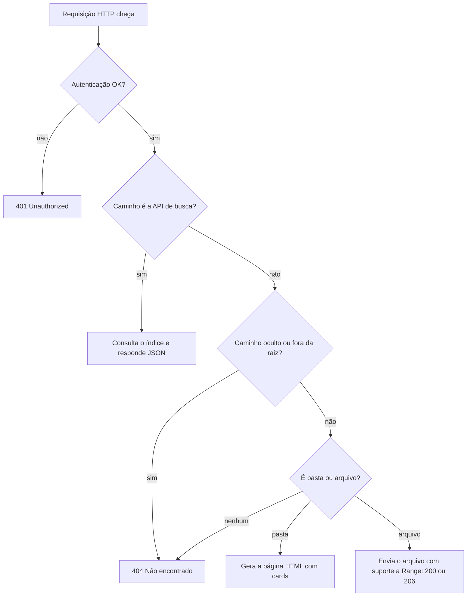

<div align="center">

# 📁 Servidor Web Python para Gerenciamento de Arquivos

**Navegue por pastas, busque arquivos e toque áudios e vídeos direto no navegador.**
Um servidor local, leve e sem dependências externas, feito só com a biblioteca padrão do Python.


</div>

---

## 📑 Sumário

1. [Visão geral](#-visão-geral)
2. [Recursos](#-recursos)
3. [Início rápido](#-início-rápido)
4. [Parâmetros de linha de comando](#-parâmetros-de-linha-de-comando)
5. [Acessando de outros dispositivos](#-acessando-de-outros-dispositivos-celular-tv-outro-pc)
6. [Scripts do Windows (`.bat` e `.vbs`)](#-scripts-do-windows-bat-e-vbs)
7. [Como funciona por dentro](#-como-funciona-por-dentro)
8. [Referência de métodos e funções](#-referência-de-métodos-e-funções)
9. [API de busca](#-api-de-busca)
10. [Segurança](#-segurança)
11. [Solução de problemas](#-solução-de-problemas)
12. [Limitações conhecidas](#-limitações-conhecidas)
13. [Estrutura do projeto](#-estrutura-do-projeto)
14. [Roadmap](#-roadmap)
15. [Referências](#-referências)
16. [Licença](#-licença)

---

## 📌 Visão geral

Este projeto transforma qualquer pasta do seu computador em um **site local** para navegar e consumir arquivos. É ideal para:

- 🎶 ouvir sua coleção de músicas no celular, sem instalar app;
- 🎬 assistir vídeos do PC na TV ou no tablet, pela rede Wi-Fi;
- 🔎 achar rapidamente um arquivo em centenas de pastas;
- 📤 compartilhar arquivos com outras pessoas da mesma rede.

Tudo roda em **um único arquivo Python** (`web_server_enhanced.py`), sem `pip install` de nada.

<!--
📸 Dica: adicione prints reais da interface em uma pasta docs/ e referencie aqui:


-->

---

## ✨ Recursos

| Recurso | O que faz |
|---|---|
| 📂 **Navegação por pastas** | Lista pastas e arquivos em cards, com breadcrumbs e botão "voltar". Pastas aparecem antes dos arquivos, em ordem alfabética sem diferenciar maiúsculas de minúsculas. |
| 🎵 **Player de áudio** | Toca MP3, WAV, OGG, M4A, AAC e FLAC com o player nativo do navegador. |
| 🎬 **Player de vídeo** | Toca MP4, WebM e MOV. AVI, MKV, WMV e FLV aparecem com player, mas **dependem do codec e do navegador** (veja [limitações](#-limitações-conhecidas)). |
| ⏩ **Avançar e retroceder** | Suporte completo a `Range` (HTTP 206), então dá para pular para qualquer ponto de um vídeo ou música longa. |
| 🔍 **Busca em tempo real** | Busca em **todas** as subpastas enquanto você digita, ignorando acentos e maiúsculas (`sao joao` encontra `São João`). |
| 🖼️ **Pré-visualização de imagens** | Mostra miniaturas com carregamento preguiçoso (`lazy`) nos cards. |
| 📱 **Responsivo** | Layout em grade que se adapta ao celular e ao desktop. |
| 🔐 **Autenticação opcional** | Senha via HTTP Basic com `--auth usuario:senha`. |
| 🧵 **Multi-thread** | Um vídeo em reprodução não trava o acesso de outros usuários. |
| 🙈 **Arquivos ocultos protegidos** | Qualquer caminho com parte iniciada por `.` (`.env`, `.ssh/`…) retorna 404, inclusive no acesso direto. |
| ⚡ **Sem dependências** | Só biblioteca padrão do Python. |

---

## 🚀 Início rápido

### Pré-requisitos

- **Python 3.8 ou superior** ([download](https://www.python.org/downloads/)). No Windows, marque *"Add Python to PATH"* na instalação.
- Permissão de leitura na pasta que você quer servir.

Confira se o Python está instalado:

```bash
python --version      # Windows
python3 --version     # Linux / macOS
```

### Instalação

```bash
git clone https://github.com/eduardogrigorio/Web-Server-Python.git
cd Web-Server-Python
```

Não há nada para instalar além do próprio Python.

### Primeira execução

Sirva a **pasta atual** (acessível só no seu computador):

```bash
python web_server_enhanced.py
```

Abra no navegador: **http://localhost:8082**

Sirva uma **pasta específica** em outra porta:

```bash
# Windows
python web_server_enhanced.py "D:\Musicas" 9000

# Linux / macOS
python3 web_server_enhanced.py ~/Musicas 9000
```

Para encerrar, pressione `Ctrl + C` no terminal.

---

## ⚙️ Parâmetros de linha de comando

```
python web_server_enhanced.py [DIRETORIO] [PORTA] [--host HOST] [--title TITULO] [--auth USUARIO:SENHA]
```

| Parâmetro | Obrigatório | Padrão | Descrição |
|---|:---:|---|---|
| `DIRETORIO` | não | pasta atual | Pasta que será exibida no site. |
| `PORTA` | não | `8082` | Porta TCP de escuta. |
| `--host` | não | `127.0.0.1` | Endereço de escuta. Use `0.0.0.0` para liberar o acesso na rede local. |
| `--title` | não | `Ligações Kainos` | Título exibido no topo da página e na aba do navegador. |
| `--auth` | não | desativada | Ativa senha (HTTP Basic) no formato `usuario:senha`. |
| `-h`, `--help` | não | — | Mostra a ajuda. |

### Exemplos

```bash
# Só no seu PC, sem senha
python web_server_enhanced.py ~/Videos 8082

# Liberado na rede Wi-Fi, com senha e título próprio
python web_server_enhanced.py ~/Videos 8082 --host 0.0.0.0 --auth maria:segredo123 --title "Meus Vídeos"
```

---

## 📱 Acessando de outros dispositivos (celular, TV, outro PC)

Por segurança, o servidor **só escuta no próprio computador** (`127.0.0.1`). Para acessar de outro aparelho:

1. **Inicie com `--host 0.0.0.0`** (e, de preferência, `--auth`):
   ```bash
   python web_server_enhanced.py ~/Musicas 8082 --host 0.0.0.0 --auth usuario:senha
   ```
2. **Veja o endereço de rede** impresso no console, por exemplo `http://192.168.0.15:8082`.
3. **Digite esse endereço** no navegador do outro aparelho. Ele precisa estar **na mesma rede Wi-Fi**.
4. **Se não abrir**, libere a porta no firewall do Windows (execute como administrador):
   ```bat
   netsh advfirewall firewall add rule name="Servidor Web Python" dir=in action=allow protocol=TCP localport=8082
   ```

> ⚠️ Sem `--auth`, **qualquer pessoa na sua rede** poderá ver e baixar os arquivos da pasta. O console mostra um aviso quando isso acontece.

---

## 🪟 Scripts do Windows (`.bat` e `.vbs`)

O repositório traz dois atalhos para quem usa Windows e não quer digitar comandos. Eles fazem o mesmo trabalho de formas diferentes.

### `iniciar_servidor_web.bat`: inicializador interativo

Abre uma janela de console e prepara tudo antes de ligar o servidor. Passo a passo do que ele faz:

| # | Etapa | Detalhe |
|:-:|---|---|
| 1 | **Parâmetros** | Define a porta (`8082`), a pasta servida (`C:\temp\webserverpython`) e o nome do script. Edite as variáveis no topo do arquivo para mudar. |
| 2 | **Verifica o Python** | Usa `where python`. Se não achar, mostra o link de download e sai. |
| 3 | **Verifica a pasta** | Se ela não existir, pergunta se deve criá-la. Depois entra nela. |
| 4 | **Copia o servidor** | Se `web_server_enhanced.py` não estiver na pasta, copia a partir da pasta do `.bat`. |
| 5 | **Verifica a porta** | Roda `netstat`. Se a porta estiver em uso, pergunta outra. |
| 6 | **Descobre o IP** | Lê o IPv4 via `ipconfig` e mostra os endereços de acesso. |
| 7 | **Inicia** | Abre o navegador em `http://localhost:PORTA/` e executa `python web_server_enhanced.py "PASTA" PORTA`. |

**Como usar:** dê dois cliques no arquivo.

### `start_servidor_web.vbs`: inicializador invisível

São 3 linhas que usam o objeto `WScript.Shell` para executar o Python **com a janela oculta** (o `0` no final do `.Run`). O servidor sobe em segundo plano, sem console, e por isso é ótimo para colocar na inicialização do Windows.

```vbs
Set WshShell = CreateObject("WScript.Shell")
WshShell.Run "C:\caminho\python.exe C:\caminho\web_server_enhanced.py", 0
Set WshShell = Nothing
```

**Antes de usar**, troque os `C:\caminho\...` pelos caminhos reais. Exemplo completo, já servindo uma pasta, na porta 8082 e na rede, com senha:

```vbs
Set WshShell = CreateObject("WScript.Shell")
WshShell.Run """C:\Python312\python.exe"" ""C:\temp\webserverpython\web_server_enhanced.py"" ""D:\Musicas"" 8082 --host 0.0.0.0 --auth usuario:senha", 0
Set WshShell = Nothing
```

> As aspas duplas repetidas (`""`) são o jeito do VBScript de escapar aspas dentro de uma string. Elas permitem caminhos com espaços.

**Iniciar junto com o Windows:** pressione `Win + R`, digite `shell:startup` e coloque um **atalho** do `.vbs` nessa pasta.

**Parar o servidor:** como não há janela, abra o *Gerenciador de Tarefas* e encerre o processo `python.exe`.

### ⚠️ Ajuste necessário na versão atual do servidor

O servidor agora escuta só em `127.0.0.1` por padrão. Por isso, o endereço de "Rede" mostrado pelo `.bat` só funciona se você incluir `--host 0.0.0.0`. Altere a última linha de comando do `.bat`:

```bat
python "%SERVIDOR_PY%" "%DIRETORIO%" %PORTA% --host 0.0.0.0 --auth usuario:senha
```

### Pegadinhas conhecidas dos scripts

- **Cópia desatualizada:** o `.bat` só copia o `.py` se ele **não existir** na pasta de destino. Se você atualizar o repositório, apague `C:\temp\webserverpython\web_server_enhanced.py` (ou copie por cima) para usar a versão nova.
- **`index 2.html` não tem efeito:** o bloco que o copia como `index.html` é inútil, porque o servidor sempre gera a listagem de pastas e não serve `index.html` automaticamente.
- **Acentos no console:** o `chcp 1252` pode exibir "não", "diretório" etc. com caracteres estranhos, dependendo da codificação do arquivo.
- **O IP mostrado pode estar errado:** o `.bat` pega o primeiro IPv4 do `ipconfig`, que pode ser de uma placa virtual (VPN, WSL, VirtualBox). Confira o IP impresso pelo próprio servidor.
- **O navegador abre antes do servidor:** se aparecer erro de conexão, pressione `F5`.

---

## 🧠 Como funciona por dentro

### Fluxo de uma requisição



### Conceitos usados

- **`ThreadingHTTPServer`**: cria uma thread por conexão, então streams longos não bloqueiam os demais.
- **Índice em cache**: a lista de arquivos é montada uma vez e reaproveitada por **30 segundos**, evitando percorrer o disco a cada busca.
- **Normalização de texto**: remove acentos (`unicodedata`), troca `_`, `-` e `.` por espaço e ignora maiúsculas.
- **`Range` requests**: o navegador pede só o trecho de que precisa (`bytes=1000-1999`) e o servidor responde `206 Partial Content`. É isso que permite avançar em um vídeo.
- **Proteção de caminho**: três camadas, que são bloquear partes ocultas (`.`), normalizar o caminho (`translate_path` descarta `..`) e conferir com `realpath` se o destino final está dentro da pasta raiz (o que barra symlinks que apontam para fora).

---

## 📚 Referência de métodos e funções

Tudo está em `web_server_enhanced.py`.

### Constantes

| Constante | Valor | Uso |
|---|---|---|
| `DEFAULT_PORT` | `8082` | Porta padrão. |
| `DEFAULT_TITLE` | `"Ligações Kainos"` | Título padrão do site. |
| `MAX_SEARCH_RESULTS` | `100` | Máximo de resultados por busca. |
| `INDEX_TTL_SECONDS` | `30` | Validade do índice em cache. |
| `CHUNK` | `64 KB` | Tamanho de cada bloco enviado no streaming. |
| `AUDIO_/VIDEO_/IMAGE_/DOCUMENT_EXTENSIONS` | conjuntos | Extensões reconhecidas por tipo. |

### Funções utilitárias

| Função | O que faz |
|---|---|
| `get_file_type(filename)` | Retorna `audio`, `video`, `image`, `document` ou `file` pela extensão. |
| `fmt_size(n)` | Converte bytes em `B`, `KB`, `MB`, `GB` ou `TB`. |
| `fmt_title(name)` | Transforma `minha_musica-ao_vivo.mp3` em `Minha Musica Ao Vivo`. |
| `norm(text)` | Normaliza para busca: sem acentos, minúsculas, separadores viram espaço. |
| `is_hidden_path(url_path)` | `True` se alguma parte do caminho começa com `.`. |
| `url_quote_path(rel_posix)` | Monta uma URL com *percent-encoding* a partir de um caminho relativo. |

### Classe `FileIndex`

| Método | O que faz |
|---|---|
| `__init__(root, ttl)` | Guarda a raiz, o tempo de validade e um `Lock` para uso com várias threads. |
| `_build()` | Percorre a árvore com `os.walk`, ignorando ocultos, e monta a lista de arquivos. |
| `get()` | Devolve o índice, reconstruindo-o se tiver passado do prazo. |
| `search(query)` | Exige que **todas** as palavras da busca apareçam no nome, ordena por relevância e só então limita a 100. |

### Classe `FileServerHandler` (herda de `SimpleHTTPRequestHandler`)

| Método | O que faz |
|---|---|
| `handle()` | Executa o tratamento padrão e silencia `ConnectionReset`/`BrokenPipe`, comuns em streaming. |
| `check_auth()` | Valida o cabeçalho `Authorization` com `hmac.compare_digest` (comparação resistente a timing attack) e responde `401` se falhar. |
| `is_inside_root(fs_path)` | Garante, via `realpath`, que o destino está dentro da pasta raiz. |
| `do_GET()` / `do_HEAD()` | Entradas HTTP; ambas chamam `dispatch`. |
| `dispatch(head_only)` | Roteia: autenticação → API → bloqueio de ocultos → pasta ou arquivo. |
| `handle_search_api(parsed, head_only)` | Responde `/api/search` em JSON, sem CORS. |
| `serve_file(fs_path, head_only)` | Envia o arquivo em blocos, com `Content-Length`, `Accept-Ranges` e respostas `200`, `206` ou `416`. |
| `build_breadcrumbs(url_path)` | Gera o caminho de navegação com links escapados. |
| `list_directory_enhanced(fs_path, url_path, head_only)` | Monta os cards (pastas, áudio, vídeo, imagem, outros) e injeta no `TEMPLATE`. |

### Funções de inicialização

| Função | O que faz |
|---|---|
| `get_local_ip()` | Descobre o IP local (via socket UDP, sem enviar dados). |
| `parse_args()` | Define e lê os parâmetros com `argparse`. |
| `run_server()` | Valida a pasta, configura o handler, aplica `--auth` e inicia o `ThreadingHTTPServer`. |

---

## 🔌 API de busca

### `GET /api/search?q=<termo>`

Retorna os arquivos cujo nome contém **todas** as palavras do termo.

**Exemplo**

```bash
curl "http://localhost:8082/api/search?q=sao%20joao"
```

```json
{
  "results": [
    {
      "name": "são joão_1.mp3",
      "path": "/Músicas Boas/são joão_1.mp3",
      "url": "/M%C3%BAsicas%20Boas/s%C3%A3o%20jo%C3%A3o_1.mp3",
      "size": 100000,
      "modified": "2026-10-21T20:06:12.101149",
      "type": "audio",
      "icon": "🎵"
    }
  ],
  "total": 1
}
```

| Campo | Descrição |
|---|---|
| `name` | Nome do arquivo. |
| `path` | Caminho legível, relativo à raiz. |
| `url` | Caminho já com *percent-encoding*, pronto para usar em `href`. |
| `size` | Tamanho em bytes. |
| `modified` | Data de modificação (ISO 8601). |
| `type` | `audio`, `video`, `image`, `document` ou `file`. |

### Códigos de resposta do servidor

| Código | Quando acontece |
|:-:|---|
| `200` | Página, JSON ou arquivo completo. |
| `206` | Trecho de arquivo (requisição com `Range`). |
| `301` | Pasta acessada sem `/` no final; redireciona para a versão com `/`. |
| `401` | Senha exigida (`--auth`) e ausente ou incorreta. |
| `404` | Caminho inexistente, oculto (`.algo`) ou fora da pasta raiz. |
| `416` | `Range` inválido para o tamanho do arquivo. |

---

## 🔒 Segurança

O que o projeto já faz:

- ✅ Escuta só em `127.0.0.1` por padrão.
- ✅ Bloqueia dotfiles e pastas ocultas (listagem, busca **e** acesso direto).
- ✅ Impede *path traversal* (`../`) e symlinks que saiam da pasta raiz.
- ✅ Escapa nomes de arquivos no HTML (`html.escape`) e monta os resultados da busca com `textContent`, prevenindo [XSS](https://owasp.org/www-community/attacks/xss/).
- ✅ Não envia cabeçalhos CORS, então outros sites não leem a API de busca.
- ✅ Autenticação opcional com comparação em tempo constante.

O que você precisa saber:

- ⚠️ **HTTP Basic não é criptografado.** Usuário e senha trafegam em Base64, o que é só codificação, e não proteção. Use **apenas em redes confiáveis** (sua casa, seu escritório).
- ⚠️ **Não exponha este servidor diretamente na internet.** Se precisar de acesso externo, coloque-o atrás de um *proxy reverso* com HTTPS (Caddy, Nginx) ou use uma VPN.
- ⚠️ Sirva **apenas a pasta necessária**, nunca a raiz do disco nem a sua pasta de usuário inteira.

---

## 🛠️ Solução de problemas

| Problema | Causa provável | Solução |
|---|---|---|
| `Porta em uso` / `Address already in use` | Outro programa usa a porta. | Use outra: `python web_server_enhanced.py . 8085`. |
| Não abre no celular | Servidor escutando só em localhost, ou firewall. | Use `--host 0.0.0.0` e libere a porta (veja [acessando de outros dispositivos](#-acessando-de-outros-dispositivos-celular-tv-outro-pc)). |
| `python` não é reconhecido | Python fora do PATH. | Reinstale marcando *Add Python to PATH*, ou use `py web_server_enhanced.py`. |
| Vídeo MKV/AVI não toca | O navegador não suporta o container ou codec. | Converta para MP4 (H.264 + AAC) ou WebM. |
| Não consigo avançar no vídeo | Cache ou proxy no meio do caminho. | Acesse direto, sem proxy; confira se a resposta traz `Accept-Ranges: bytes`. |
| Pede senha toda hora | Credenciais incorretas. | Confira o `usuario:senha` usado em `--auth`. |
| Arquivo não aparece na busca | Está em pasta oculta, ou o índice ainda não atualizou. | Arquivos com `.` no início são ignorados de propósito; aguarde até 30 segundos. |
| `.vbs` não faz nada | Caminhos de exemplo (`C:\caminho\...`) não foram trocados. | Edite o arquivo com os caminhos reais. |
| Como parar o `.vbs`? | Roda sem janela. | Gerenciador de Tarefas → encerrar `python.exe`. |

---

## ⚠️ Limitações conhecidas

- A busca é **só por nome de arquivo** (não lê o conteúdo nem metadados de tags de música).
- A busca lista **arquivos**, não pastas.
- O índice é atualizado a cada 30 segundos, então arquivos novos podem demorar a aparecer na busca.
- Não há *upload* de arquivos, apenas leitura e download.
- Symlinks que apontam para fora da pasta servida são bloqueados de propósito.
- A compatibilidade de formatos de vídeo depende do navegador (veja [formatos suportados pelo navegador](https://developer.mozilla.org/en-US/docs/Web/Media/Formats)).

---

## 🗂️ Estrutura do projeto

```
Web-Server-Python/
├── web_server_enhanced.py      # Servidor (todo o código Python)
├── iniciar_servidor_web.bat    # Inicializador interativo para Windows
├── start_servidor_web.vbs      # Inicializador invisível (segundo plano) para Windows
├── README.md                   # Este arquivo
└── LICENSE                     # Licença MIT (adicione o arquivo ao repositório)
```

---

## 🗺️ Roadmap

- [x] Player de áudio e vídeo
- [x] Busca em tempo real sem acentos
- [x] Suporte a `Range` (avançar e retroceder)
- [x] Servidor multi-thread
- [x] Autenticação básica opcional
- [ ] Filtros por tipo de arquivo (áudio, vídeo, imagem…) na busca
- [ ] Miniaturas geradas para imagens grandes
- [ ] Suporte a HTTPS (`--cert` e `--key`)
- [ ] Busca por pastas e por metadados (tags ID3)
- [ ] Playlist e reprodução contínua de áudios
- [ ] Imagem Docker

Sugestões e *pull requests* são bem-vindos.

---

## 🔗 Referências

**Python**
- [`http.server`: servidores HTTP](https://docs.python.org/3/library/http.server.html), incluindo `SimpleHTTPRequestHandler` e `ThreadingHTTPServer`
- [`argparse`: parâmetros de linha de comando](https://docs.python.org/3/library/argparse.html)
- [`unicodedata`: normalização de texto](https://docs.python.org/3/library/unicodedata.html)
- [`hmac.compare_digest`](https://docs.python.org/3/library/hmac.html#hmac.compare_digest)
- [`os.walk`](https://docs.python.org/3/library/os.html#os.walk) e [`pathlib`](https://docs.python.org/3/library/pathlib.html)

**HTTP e web**
- [Requisições `Range` (MDN)](https://developer.mozilla.org/en-US/docs/Web/HTTP/Range_requests)
- [Autenticação HTTP Basic (MDN)](https://developer.mozilla.org/en-US/docs/Web/HTTP/Authentication)
- [CORS (MDN)](https://developer.mozilla.org/en-US/docs/Web/HTTP/CORS)
- [Formatos de mídia suportados pelos navegadores (MDN)](https://developer.mozilla.org/en-US/docs/Web/Media/Formats)

**Segurança**
- [OWASP: Cross-Site Scripting (XSS)](https://owasp.org/www-community/attacks/xss/)
- [OWASP: Path Traversal](https://owasp.org/www-community/attacks/Path_Traversal)

**Windows**
- [`netsh advfirewall`](https://learn.microsoft.com/en-us/windows-server/administration/windows-commands/netsh-advfirewall)
- [`netstat`](https://learn.microsoft.com/en-us/windows-server/administration/windows-commands/netstat)

---

## 📄 Licença

Distribuído sob a licença **MIT**. Consulte o arquivo `LICENSE` para mais detalhes.

<div align="center">

Feito com 🐍 Python · Se este projeto te ajudou, deixe uma ⭐ no repositório

</div>
